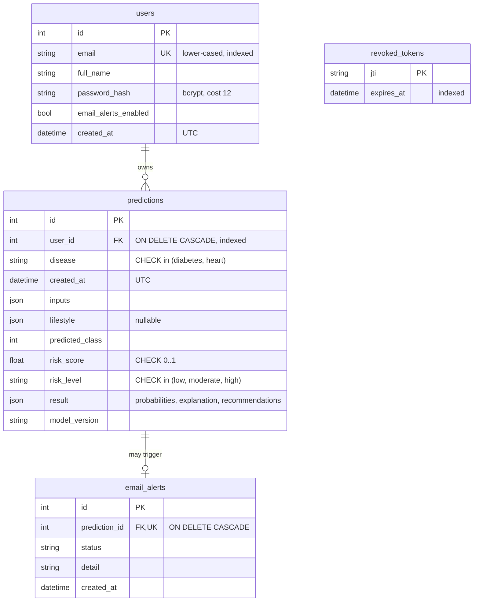

# Database schema

Engine: SQLite by default (`data/app.db`, created automatically on first start). Any SQLAlchemy URL can be
set with `DATABASE_URL` (PostgreSQL would need the `psycopg` driver added; not tested). ORM: SQLAlchemy 2.x,
models in `backend/app/models.py`. Tables are created with `Base.metadata.create_all` at startup
(`backend/app/db.py::init_db`). SQLite foreign keys are switched on for every connection
(`PRAGMA foreign_keys=ON`) so cascades work.

## Tables

### users
| Column | Type | Constraints |
|---|---|---|
| id | INTEGER | primary key |
| email | VARCHAR(254) | unique, indexed, not null; stored lower-case |
| full_name | VARCHAR(100) | not null |
| password_hash | VARCHAR(100) | not null; bcrypt `$2b$12$...` |
| email_alerts_enabled | BOOLEAN | not null, default true |
| created_at | DATETIME | not null, UTC |

### predictions
| Column | Type | Constraints |
|---|---|---|
| id | INTEGER | primary key |
| user_id | INTEGER | FK users.id ON DELETE CASCADE, not null, indexed |
| disease | VARCHAR(20) | CHECK `disease IN ('diabetes','heart')` |
| created_at | DATETIME | not null, UTC |
| inputs | JSON | validated model inputs (null = not provided) |
| lifestyle | JSON | nullable; lifestyle inputs |
| predicted_class | INTEGER | argmax class |
| risk_score | FLOAT | CHECK 0-1 |
| risk_level | VARCHAR(10) | CHECK in low/moderate/high |
| result | JSON | full response: probabilities, component probabilities, warnings, SHAP explanation, recommendations, model info |
| model_version | VARCHAR(64) | e.g. `heart-hybrid-2026-10-15T10:49:54+00:00` |

Composite index `ix_predictions_user_created (user_id, created_at)` serves the history listing.

Storing the whole `result` keeps the record and the PDF faithful to what the user saw, even after the models are
retrained.

### email_alerts
One row per prediction that qualified for an alert. `prediction_id` is UNIQUE, which makes duplicate alerts
impossible even under concurrent requests. `status`: `pending`, `sent` (accepted by the SMTP server),
`written_to_file` (test mode), `disabled`, `failed` (with error text in `detail`).

### revoked_tokens
Logout/password-change denylist of JWT ids until their expiry. Expired rows are deleted whenever a new token is
revoked.

## Ownership and authorisation rules

* Every prediction query filters by `user_id = current user`. Fetching, deleting or downloading another user's
  record returns 404 (tested in `tests/integration/test_api.py::test_users_cannot_access_each_others_records`).
* Deleting a user deletes their predictions and alerts (cascade; tested).
* There is no admin role; no endpoint lists other users.

## Initialisation and migrations

* First start creates all tables. To reset a local install: stop the server and delete `data/app.db`.
* Tests use a fresh temporary database per test (`tests/conftest.py`).
* There is no migration tool. `create_all` only creates missing tables; it does not alter existing ones. If you
  change a model, either delete the dev database or add Alembic (recommended before any shared deployment; see
  FINAL_RECOMMENDATIONS.md).

## Backup and recovery (local)

* Stop the backend, then copy `data/app.db` somewhere safe (it is one file). Restore by copying it back.
* With the server running, use SQLite's online backup: `sqlite3 data/app.db ".backup data/app-backup.db"`.
* The database holds personal health inputs. Keep backups on encrypted storage and do not email or upload them.
