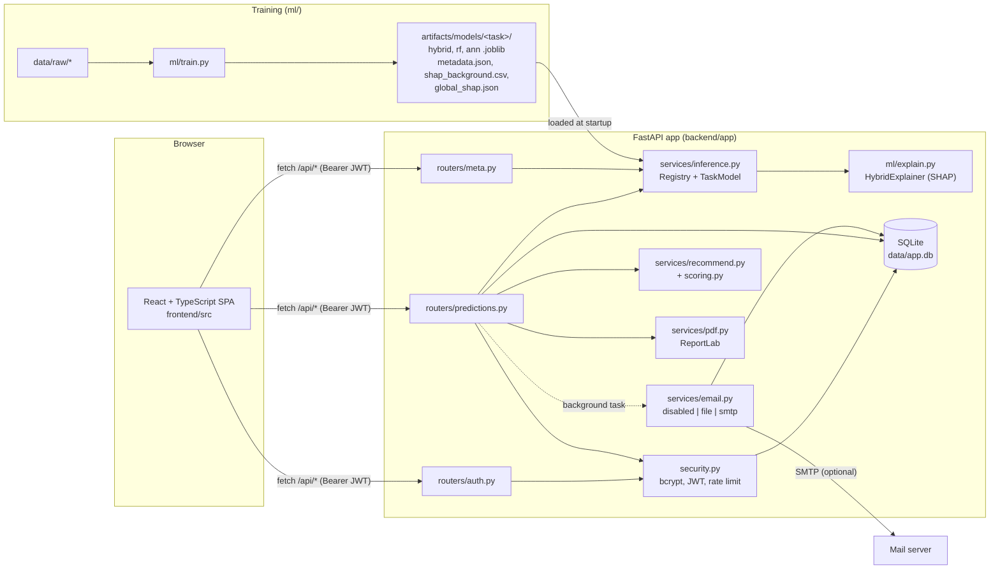
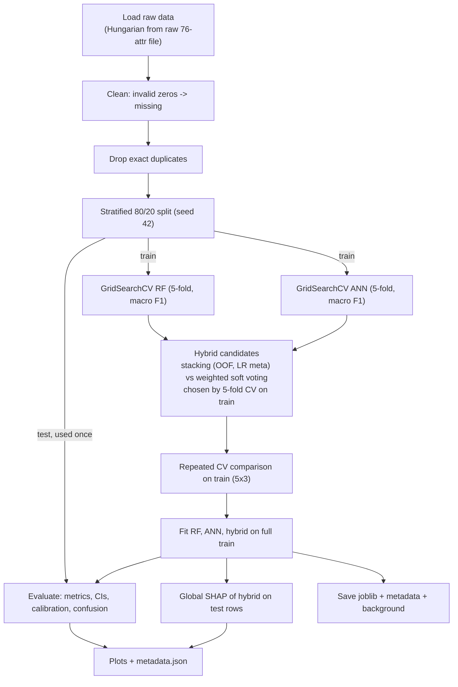
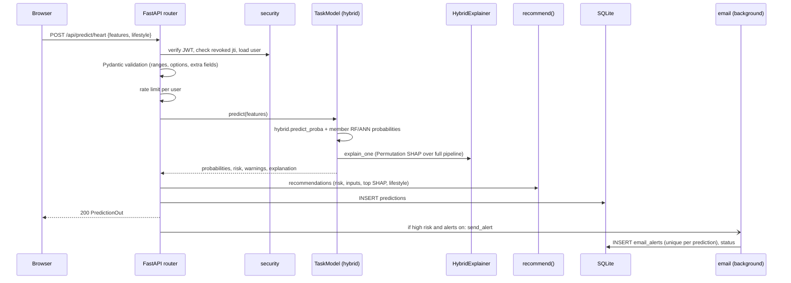

# Project architecture

Local-first, three parts: a React single-page app, a FastAPI backend that also serves the built app, and an
offline ML training pipeline that writes model artifacts the backend loads.

## System overview



## Module responsibilities

| Module | Responsibility |
|---|---|
| `ml/data.py` | Dataset loaders, cleaning, **feature specification** shared by training, API and UI |
| `ml/pipelines.py` | Preprocessors, RF, ANN, stacking and soft-voting hybrids, tuning grids |
| `ml/train.py` | Split, tune, select hybrid, CV comparison, test evaluation, SHAP global, artifacts |
| `ml/evaluate.py` | Metrics, bootstrap CIs, calibration, plots |
| `ml/explain.py` | SHAP on the hybrid output; global importance; plain-language summaries |
| `ml/audit_datasets.py`, `ml/external_t1d_check.py` | Dataset profiling; exploratory T1D cohort check |
| `backend/app/main.py` | App factory, startup (DB + model loading), CORS, security headers, error handlers, SPA serving |
| `backend/app/config.py` | Environment-based settings |
| `backend/app/security.py` | Password hashing, JWT, auth dependencies, token revocation, rate limiter |
| `backend/app/routers/*` | HTTP endpoints |
| `backend/app/services/*` | Inference, recommendations, scoring, PDF, email |
| `frontend/src/api.ts` | Typed API client, token storage |
| `frontend/src/pages/*`, `components/*` | Screens and UI components |

## Training pipeline



## Prediction request flow



## Authentication flow

```mermaid
sequenceDiagram
    participant U as Browser
    participant B as Backend
    participant D as SQLite
    U->>B: POST /api/auth/register
    B->>D: INSERT user (bcrypt hash)
    U->>B: POST /api/auth/login
    B->>D: SELECT user; bcrypt verify
    B-->>U: JWT (sub, jti, exp 60 min)
    Note over U: token kept in memory + sessionStorage
    U->>B: requests with Authorization: Bearer
    U->>B: POST /api/auth/logout
    B->>D: INSERT revoked_tokens(jti)
```

## Report generation

`GET /api/predictions/{id}/report.pdf` -> ownership check -> `services/pdf.py::build_report(prediction, user)`
reads the stored `inputs` and `result` and draws: header, result with risk band, probability table (hybrid and
both components), warnings, SHAP bar chart and summary, inputs table, BMI and lifestyle score,
recommendations with sources, model information and the disclaimer. The PDF is built in memory and streamed;
nothing is written to disk.

## Deployment shape

Development: Vite dev server on :5173 proxies `/api` to Uvicorn on :8000. Local "production": `npm run build`
once, then only Uvicorn on :8000 serves both the API and `frontend/dist`.
